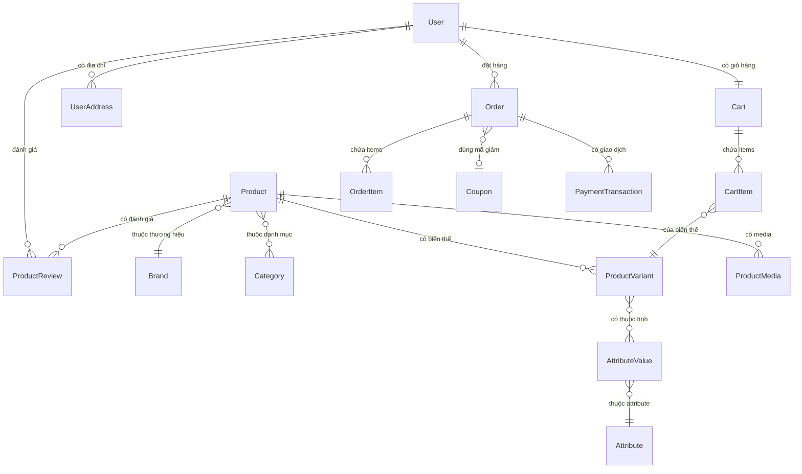

# 📋 KẾ HOẠCH XÂY DỰNG FRONTEND — Core E-commerce (Thiết Bị Điện)

---

## 1. PHÂN TÍCH HIỆN TRẠNG

### 1.1 Kiến trúc hệ thống

| Thành phần | Công nghệ | Trạng thái |
|---|---|---|
| **Backend** | Laravel 11 + Sanctum + MySQL 8 + Redis | ✅ Đã xây dựng cơ bản |
| **Frontend** | React 19 + TypeScript + Vite 8 + TailwindCSS 4 | 🟡 Mới khởi tạo |
| **Routing** | react-router-dom v7 | ✅ Đã cài đặt |
| **HTTP Client** | Axios | ✅ Đã cài đặt |
| **Icons** | lucide-react | ✅ Đã cài đặt |
| **Infrastructure** | Docker Compose (nginx, mysql, redis) | ✅ Đã cấu hình |

### 1.2 Backend API đã sẵn sàng

| API Endpoint | Method | Mục đích | Controller |
|---|---|---|---|
| `/api/products` | GET | Danh sách sản phẩm (catalog) | Shop\ProductController@index |
| `/api/products/{slug}` | GET | Chi tiết sản phẩm | Shop\ProductController@show |
| `/api/cart` | GET | Xem giỏ hàng | Shop\CartController@index |
| `/api/cart` | POST | Thêm vào giỏ hàng | Shop\CartController@store |
| `/api/cart/{itemId}` | PUT | Cập nhật số lượng | Shop\CartController@update |
| `/api/cart/{itemId}` | DELETE | Xóa item khỏi giỏ | Shop\CartController@destroy |
| `/api/checkout` | POST | Đặt hàng / Thanh toán | Shop\OrderController@store |
| `/api/products` | POST | [Admin] Tạo sản phẩm | Admin\ProductController@store |
| `/api/orders/{id}/status` | PATCH | [Admin] Cập nhật trạng thái đơn | Admin\OrderController@updateStatus |
| `/api/user` | GET | Thông tin user (Sanctum) | Closure |

### 1.3 Data Models (17 Models)



### 1.4 Frontend hiện tại — Những gì đã có

| Mục | File | Trạng thái |
|---|---|---|
| Page chi tiết sản phẩm | [ProductDetail.tsx](file:///c:/Users/Asfy-08/core-ecommerce-base/frontend/src/pages/shop/ProductDetail.tsx) | ✅ Đã hoàn thiện cơ bản |
| Service lấy sản phẩm | [productService.ts](file:///c:/Users/Asfy-08/core-ecommerce-base/frontend/src/services/productService.ts) | ✅ getProducts, getProductDetail |
| Service giỏ hàng | [cartService.ts](file:///c:/Users/Asfy-08/core-ecommerce-base/frontend/src/services/cartService.ts) | ✅ CRUD cart + session |
| Types sản phẩm | [product.ts](file:///c:/Users/Asfy-08/core-ecommerce-base/frontend/src/types/product.ts) | ✅ Product, Variant, Brand, Attribute, Media |
| Routing cơ bản | [App.tsx](file:///c:/Users/Asfy-08/core-ecommerce-base/frontend/src/App.tsx) | 🟡 Chỉ có / và /products/:slug |

> [!IMPORTANT]
> Frontend hiện rất sơ khai: chỉ có 1 page (ProductDetail), không có layout, không có component tái sử dụng, không có hệ thống auth, chưa có admin panel.

---

## 2. KIẾN TRÚC FRONTEND ĐỀ XUẤT

### 2.1 Cấu trúc thư mục

```
frontend/src/
├── assets/                    # Static assets (images, fonts)
├── components/
│   ├── common/                # Shared UI components
│   │   ├── Button.tsx
│   │   ├── Input.tsx
│   │   ├── Modal.tsx
│   │   ├── Badge.tsx
│   │   ├── Skeleton.tsx       # Loading skeleton
│   │   ├── Pagination.tsx
│   │   ├── StarRating.tsx
│   │   ├── PriceDisplay.tsx
│   │   ├── EmptyState.tsx
│   │   └── Toast.tsx          # Notification toast
│   ├── shop/
│   │   ├── Header/
│   │   │   ├── Navbar.tsx
│   │   │   ├── SearchBar.tsx
│   │   │   ├── CartIcon.tsx
│   │   │   └── UserMenu.tsx
│   │   ├── Footer.tsx
│   │   ├── ProductCard.tsx
│   │   ├── ProductGrid.tsx
│   │   ├── CategorySidebar.tsx
│   │   ├── FilterPanel.tsx
│   │   ├── CartDrawer.tsx     # Slide-out cart
│   │   ├── ReviewSection.tsx
│   │   ├── ImageGallery.tsx
│   │   └── BrandBanner.tsx
│   └── admin/
│       ├── Sidebar.tsx
│       ├── TopBar.tsx
│       ├── StatCard.tsx
│       ├── DataTable.tsx
│       ├── OrderStatusBadge.tsx
│       └── ProductForm.tsx
├── contexts/                  # React Context providers
│   ├── AuthContext.tsx
│   ├── CartContext.tsx
│   └── ToastContext.tsx
├── hooks/
│   ├── useAuth.ts
│   ├── useCart.ts
│   ├── useProducts.ts
│   ├── useDebounce.ts
│   └── useLocalStorage.ts
├── layouts/
│   ├── ShopLayout.tsx         # Header + Footer + Main
│   └── AdminLayout.tsx        # Sidebar + TopBar + Main
├── pages/
│   ├── shop/
│   │   ├── HomePage.tsx
│   │   ├── ProductList.tsx
│   │   ├── ProductDetail.tsx  # (đã có)
│   │   ├── CartPage.tsx
│   │   ├── CheckoutPage.tsx
│   │   ├── OrderSuccess.tsx
│   │   ├── OrderTracking.tsx
│   │   ├── LoginPage.tsx
│   │   ├── RegisterPage.tsx
│   │   ├── AccountPage.tsx
│   │   └── NotFound.tsx
│   └── admin/
│       ├── Dashboard.tsx
│       ├── ProductManagement.tsx
│       ├── OrderManagement.tsx
│       ├── OrderDetail.tsx
│       ├── CategoryManagement.tsx
│       ├── CouponManagement.tsx
│       └── SettingsPage.tsx
├── services/
│   ├── apiClient.ts           # Axios instance + interceptors
│   ├── productService.ts     # (đã có)
│   ├── cartService.ts        # (đã có)
│   ├── authService.ts
│   ├── orderService.ts
│   ├── categoryService.ts
│   ├── couponService.ts
│   └── adminService.ts
├── types/
│   ├── product.ts             # (đã có)
│   ├── cart.ts
│   ├── order.ts
│   ├── user.ts
│   ├── category.ts
│   ├── coupon.ts
│   └── api.ts                 # ApiResponse, PaginatedResult, etc.
├── utils/
│   ├── formatCurrency.ts
│   ├── formatDate.ts
│   └── cn.ts                  # clsx + tailwind-merge helper
├── App.tsx
├── App.css
├── index.css
└── main.tsx
```

### 2.2 Routing Map

```mermaid
graph TD
    A["/"] --> B["ShopLayout"]
    B --> C["/ → HomePage"]
    B --> D["/san-pham → ProductList"]
    B --> E["/san-pham/:slug → ProductDetail"]
    B --> F["/gio-hang → CartPage"]
    B --> G["/thanh-toan → CheckoutPage"]
    B --> H["/dat-hang-thanh-cong → OrderSuccess"]
    B --> I["/theo-doi-don-hang → OrderTracking"]
    B --> J["/dang-nhap → LoginPage"]
    B --> K["/dang-ky → RegisterPage"]
    B --> L["/tai-khoan → AccountPage"]

    M["/admin"] --> N["AdminLayout"]
    N --> O["/admin → Dashboard"]
    N --> P["/admin/san-pham → ProductManagement"]
    N --> Q["/admin/don-hang → OrderManagement"]
    N --> R["/admin/don-hang/:id → OrderDetail"]
    N --> S["/admin/danh-muc → CategoryManagement"]
    N --> T["/admin/ma-giam-gia → CouponManagement"]
    N --> U["/admin/cai-dat → SettingsPage"]
```



---

## 3. KẾ HOẠCH THỰC HIỆN THEO PHA

### ═══════════════════════════════════════
### 🏗️ PHA 0 — NỀN TẢNG & DESIGN SYSTEM (Ưu tiên: ⚡ CRITICAL)
### ═══════════════════════════════════════

> Mục tiêu: Thiết lập nền tảng vững chắc trước khi xây dựng bất kỳ page nào.

| # | Task | File(s) | Mô tả |
|---|---|---|---|
| 0.1 | API Client & Interceptors | `services/apiClient.ts` | Tạo Axios instance với baseURL, interceptors (token attach, error handling, refresh token logic) |
| 0.2 | Utility `cn()` | `utils/cn.ts` | Hàm merge className dùng `clsx` + `tailwind-merge` |
| 0.3 | Format helpers | `utils/formatCurrency.ts`, `formatDate.ts` | Format VND (`1.500.000 đ`), format ngày tháng |
| 0.4 | Design Tokens | `index.css` | Cập nhật CSS variables: brand colors, spacing, shadows, border-radius cho giao diện e-commerce thiết bị điện |
| 0.5 | Common Components | `components/common/*` | Button, Input, Modal, Badge, Skeleton, Pagination, Toast, PriceDisplay, EmptyState |
| 0.6 | Toast/Notification System | `contexts/ToastContext.tsx` | Hệ thống thông báo global (success/error/warning) |
| 0.7 | TypeScript Types | `types/*` | Bổ sung types: `cart.ts`, `order.ts`, `user.ts`, `category.ts`, `coupon.ts`, `api.ts` |

**Effort ước lượng: 2-3 ngày**

---

### ═══════════════════════════════════════
### 🛍️ PHA 1 — SHOP LAYOUT & TRANG CHỦ (Ưu tiên: 🔴 HIGH)
### ═══════════════════════════════════════

> Mục tiêu: Xây dựng khung layout và trang chủ — "mặt tiền" của cửa hàng.

| # | Task | File(s) | Mô tả |
|---|---|---|---|
| 1.1 | **Shop Layout** | `layouts/ShopLayout.tsx` | Wrapper: Header (sticky) + Main content + Footer |
| 1.2 | **Navbar / Header** | `components/shop/Header/*` | Logo, Search bar, danh mục dropdown, Cart icon (badge số lượng), User menu (Login/Tài khoản) |
| 1.3 | **Footer** | `components/shop/Footer.tsx` | Thông tin công ty, liên kết nhanh, hotline, chính sách, mạng xã hội |
| 1.4 | **Trang chủ — Hero Banner** | `pages/shop/HomePage.tsx` | Banner carousel quảng cáo sản phẩm nổi bật / khuyến mãi |
| 1.5 | **Trang chủ — Danh mục nổi bật** | `pages/shop/HomePage.tsx` | Grid các danh mục chính (Đèn LED, Aptomat, Ổ cắm, Dây điện...) với icon/hình ảnh |
| 1.6 | **Trang chủ — Sản phẩm nổi bật** | `pages/shop/HomePage.tsx` | Section `is_featured = true` hiển thị ProductCard dạng grid |
| 1.7 | **Trang chủ — Thương hiệu** | `pages/shop/HomePage.tsx` | Logo slider các brands (Rạng Đông, Panasonic, Schneider, Sino...) |
| 1.8 | **ProductCard** | `components/shop/ProductCard.tsx` | Card sản phẩm: thumbnail, tên, giá, giá gốc, badge giảm giá, nút thêm giỏ |
| 1.9 | **Cập nhật App.tsx** | `App.tsx` | Thêm tất cả routes mới, wrap ShopLayout |

**Effort ước lượng: 3-4 ngày**

#### 🎨 Wireframe mô tả — Trang chủ

```
┌─────────────────────────────────────────────────────────────┐
│  🔌 LOGO    [🔍 Tìm kiếm sản phẩm...]    🛒(3)  👤 Đăng nhập │
├─────────────────────────────────────────────────────────────┤
│ ▸ Đèn LED  ▸ Thiết bị đóng cắt  ▸ Ổ cắm  ▸ Dây cáp  ▸ ...│
├─────────────────────────────────────────────────────────────┤
│                                                             │
│  ┌───────────────────────────────────────────────────────┐  │
│  │          🎯 HERO BANNER CAROUSEL                      │  │
│  │     "Đèn LED Panel Rạng Đông - Giảm 30%"             │  │
│  │              ● ○ ○ ○                                  │  │
│  └───────────────────────────────────────────────────────┘  │
│                                                             │
│  ═══ DANH MỤC NỔI BẬT ═════════════════════════════════   │
│  ┌──────┐  ┌──────┐  ┌──────┐  ┌──────┐  ┌──────┐        │
│  │💡    │  │⚡    │  │🔌    │  │🔧    │  │📡    │        │
│  │Đèn   │  │Aptomat│  │Ổ cắm │  │Dây   │  │Tủ    │        │
│  │LED   │  │MCB   │  │Công  │  │Cáp   │  │Điện  │        │
│  └──────┘  └──────┘  └──────┘  └──────┘  └──────┘        │
│                                                             │
│  ═══ SẢN PHẨM NỔI BẬT ════════════════════════════════   │
│  ┌─────────┐ ┌─────────┐ ┌─────────┐ ┌─────────┐         │
│  │  [img]  │ │  [img]  │ │  [img]  │ │  [img]  │         │
│  │ Tên SP  │ │ Tên SP  │ │ Tên SP  │ │ Tên SP  │         │
│  │ 150.000đ│ │ 89.000đ │ │ 320.000đ│ │ 45.000đ │         │
│  │[Thêm🛒]│ │[Thêm🛒]│ │[Thêm🛒]│ │[Thêm🛒]│         │
│  └─────────┘ └─────────┘ └─────────┘ └─────────┘         │
│                                                             │
│  ═══ THƯƠNG HIỆU ĐỐI TÁC ════════════════════════════   │
│  [Rạng Đông] [Panasonic] [Schneider] [Sino] [Cadivi]      │
│                                                             │
├─────────────────────────────────────────────────────────────┤
│  FOOTER: Về chúng tôi │ Chính sách │ Hotline │ Mạng XH    │
└─────────────────────────────────────────────────────────────┘
```

---

### ═══════════════════════════════════════
### 🔍 PHA 2 — CATALOG & TÌM KIẾM (Ưu tiên: 🔴 HIGH)
### ═══════════════════════════════════════

> Mục tiêu: Người dùng có thể duyệt, lọc, tìm kiếm sản phẩm.

| # | Task | File(s) | Mô tả |
|---|---|---|---|
| 2.1 | **Trang danh sách sản phẩm** | `pages/shop/ProductList.tsx` | Grid sản phẩm + sidebar filter + sort + pagination |
| 2.2 | **Filter Panel** | `components/shop/FilterPanel.tsx` | Lọc theo: danh mục, thương hiệu, khoảng giá, rating |
| 2.3 | **Category Sidebar** | `components/shop/CategorySidebar.tsx` | Tree danh mục cha-con (parent_id) |
| 2.4 | **Search Bar nâng cao** | `components/shop/Header/SearchBar.tsx` | Auto-suggest, debounce, highlight kết quả |
| 2.5 | **Sort & View Toggle** | `pages/shop/ProductList.tsx` | Sắp xếp (giá, tên, mới nhất), toggle Grid/List view |
| 2.6 | **Product Grid** | `components/shop/ProductGrid.tsx` | Responsive grid với Skeleton loading |
| 2.7 | **Breadcrumb** | `components/common/Breadcrumb.tsx` | Trang chủ > Danh mục > Sản phẩm |
| 2.8 | **Category Service** | `services/categoryService.ts` | API lấy danh sách categories |
| 2.9 | **Hook useProducts** | `hooks/useProducts.ts` | Custom hook: fetch, filter, paginate products |

**Effort ước lượng: 3-4 ngày**

#### 🎨 Wireframe — Trang danh sách sản phẩm

```
┌─────────────────────────────────────────────────────────────┐
│ 📍 Trang chủ > Đèn LED > Đèn LED Panel                     │
├──────────────┬──────────────────────────────────────────────┤
│              │  Sắp xếp: [Mới nhất ▼]  Hiển thị: ▦ ≡      │
│  BỘ LỌC     ├──────────────────────────────────────────────┤
│              │  ┌────────┐ ┌────────┐ ┌────────┐ ┌────────┐│
│ ▾ Danh mục   │  │ [img]  │ │ [img]  │ │ [img]  │ │ [img]  ││
│  ☐ Đèn Panel │  │ Tên SP │ │ Tên SP │ │ Tên SP │ │ Tên SP ││
│  ☐ Đèn Âm trần│ │150.000đ│ │ 89.000đ│ │320.000đ│ │ 45.000đ││
│  ☐ Đèn Ốp trần│ │ ★★★★☆ │ │ ★★★★★ │ │ ★★★☆☆ │ │ ★★★★☆ ││
│              │  └────────┘ └────────┘ └────────┘ └────────┘│
│ ▾ Thương hiệu│                                              │
│  ☐ Rạng Đông │  ┌────────┐ ┌────────┐ ┌────────┐ ┌────────┐│
│  ☐ Panasonic │  │ [img]  │ │ [img]  │ │ [img]  │ │ [img]  ││
│  ☐ Philips   │  │  ...   │ │  ...   │ │  ...   │ │  ...   ││
│              │  └────────┘ └────────┘ └────────┘ └────────┘│
│ ▾ Khoảng giá │                                              │
│  50K - 500K  │         ◀ 1  2  3  4  5  ▶                  │
├──────────────┴──────────────────────────────────────────────┤
```

---

### ═══════════════════════════════════════
### 🛒 PHA 3 — GIỎ HÀNG & THANH TOÁN (Ưu tiên: 🔴 HIGH)
### ═══════════════════════════════════════

> Mục tiêu: Flow mua hàng hoàn chỉnh end-to-end.

| # | Task | File(s) | Mô tả |
|---|---|---|---|
| 3.1 | **Cart Context** | `contexts/CartContext.tsx` | Global state giỏ hàng, sync với API, badge count |
| 3.2 | **Cart Drawer** | `components/shop/CartDrawer.tsx` | Slide-out mini cart (thêm/bớt/xóa nhanh) |
| 3.3 | **Trang giỏ hàng** | `pages/shop/CartPage.tsx` | Bảng chi tiết giỏ hàng: hình ảnh, tên, variant, số lượng, đơn giá, tổng, mã giảm giá |
| 3.4 | **Trang thanh toán** | `pages/shop/CheckoutPage.tsx` | Form thông tin giao hàng (tên, SĐT, email, tỉnh/huyện/xã, địa chỉ), phương thức thanh toán, tổng kết đơn |
| 3.5 | **Trang đặt hàng thành công** | `pages/shop/OrderSuccess.tsx` | Xác nhận đơn hàng: mã đơn, thông tin giao hàng, danh sách SP, tổng tiền |
| 3.6 | **Coupon Service** | `services/couponService.ts` | API kiểm tra & áp dụng mã giảm giá |
| 3.7 | **Order Service** | `services/orderService.ts` | API tạo đơn hàng (checkout) |
| 3.8 | **Nâng cấp ProductDetail** | `pages/shop/ProductDetail.tsx` | Tích hợp CartContext, thêm toast khi add to cart, image gallery |
| 3.9 | **useCart hook** | `hooks/useCart.ts` | Custom hook wrapping CartContext |
| 3.10 | **Image Gallery** | `components/shop/ImageGallery.tsx` | Zoom, thumbnail slider, multi-image cho ProductDetail |

**Effort ước lượng: 4-5 ngày**

#### 🎨 Wireframe — Trang Checkout

```
┌─────────────────────────────────────────────────────────────┐
│ 📍 Trang chủ > Thanh toán                                   │
├─────────────────────────────────┬───────────────────────────┤
│                                 │                           │
│  THÔNG TIN GIAO HÀNG           │  ĐƠN HÀNG CỦA BẠN       │
│                                 │                           │
│  Họ và tên: [____________]      │  ┌─────────────────────┐ │
│  Số điện thoại: [________]      │  │ 🔌 Đèn LED Panel    │ │
│  Email: [________________]      │  │ 18W │ x2 │ 300.000đ│ │
│                                 │  ├─────────────────────┤ │
│  Tỉnh/TP: [Chọn ▼]            │  │ ⚡ Aptomat 2P 20A   │ │
│  Quận/Huyện: [Chọn ▼]          │  │      │ x1 │  85.000đ│ │
│  Phường/Xã: [Chọn ▼]           │  └─────────────────────┘ │
│  Địa chỉ cụ thể: [_________]   │                           │
│                                 │  Tạm tính:    385.000đ   │
│  GHI CHÚ ĐƠN HÀNG             │  Phí vận chuyển: 30.000đ  │
│  [______________________]       │  Mã giảm giá: [-15.000đ] │
│                                 │  ───────────────────────  │
│  PHƯƠNG THỨC THANH TOÁN        │  TỔNG:        400.000đ   │
│  ◉ COD - Thanh toán khi nhận   │                           │
│  ○ Chuyển khoản ngân hàng      │  [    ĐẶT HÀNG NGAY    ] │
│  ○ VNPay / Momo                │                           │
├─────────────────────────────────┴───────────────────────────┤
```

---

### ═══════════════════════════════════════
### 🔐 PHA 4 — XÁC THỰC & TÀI KHOẢN (Ưu tiên: 🟠 MEDIUM)
### ═══════════════════════════════════════

> Mục tiêu: Hệ thống đăng nhập/đăng ký, quản lý tài khoản cá nhân.

| # | Task | File(s) | Mô tả |
|---|---|---|---|
| 4.1 | **Auth Context** | `contexts/AuthContext.tsx` | Quản lý user state, token, login/logout, persist auth |
| 4.2 | **Auth Service** | `services/authService.ts` | Login, Register, Logout, Get Profile (Sanctum) |
| 4.3 | **Trang đăng nhập** | `pages/shop/LoginPage.tsx` | Form email/password, remember me, link đăng ký |
| 4.4 | **Trang đăng ký** | `pages/shop/RegisterPage.tsx` | Form tên, email, SĐT, password, confirm password |
| 4.5 | **Trang tài khoản** | `pages/shop/AccountPage.tsx` | Tabs: Thông tin cá nhân, Lịch sử đơn hàng, Sổ địa chỉ, Đổi mật khẩu |
| 4.6 | **Theo dõi đơn hàng** | `pages/shop/OrderTracking.tsx` | Timeline trạng thái đơn: pending → confirmed → packing → shipping → delivered |
| 4.7 | **useAuth hook** | `hooks/useAuth.ts` | Custom hook wrapping AuthContext |
| 4.8 | **Protected Route** | `components/common/ProtectedRoute.tsx` | Redirect về login nếu chưa auth |
| 4.9 | **Merge cart khi login** | `services/cartService.ts` | Gộp giỏ hàng vãng lai (session) vào user cart khi đăng nhập |

> [!NOTE]
> Backend đã dùng **Laravel Sanctum** cho auth API. Frontend cần gọi `/sanctum/csrf-cookie` trước khi login (nếu SPA mode) hoặc dùng token-based.

**Effort ước lượng: 3-4 ngày**

---

### ═══════════════════════════════════════
### ⭐ PHA 5 — ĐÁNH GIÁ & TƯƠNG TÁC (Ưu tiên: 🟠 MEDIUM)
### ═══════════════════════════════════════

> Mục tiêu: Đánh giá sản phẩm, tăng độ tin cậy.

| # | Task | File(s) | Mô tả |
|---|---|---|---|
| 5.1 | **Review Section** | `components/shop/ReviewSection.tsx` | Hiển thị danh sách đánh giá, phân bổ rating (5★/4★/3★...) |
| 5.2 | **Review Form** | `components/shop/ReviewForm.tsx` | Form viết đánh giá: rating sao, comment, upload ảnh |
| 5.3 | **Star Rating component** | `components/common/StarRating.tsx` | Interactive star rating (read-only & editable) |
| 5.4 | **Review Service** | `services/reviewService.ts` | API CRUD review |
| 5.5 | **Tích hợp vào ProductDetail** | `pages/shop/ProductDetail.tsx` | Thêm ReviewSection bên dưới thông số kỹ thuật |

**Effort ước lượng: 2 ngày**

---

### ═══════════════════════════════════════
### 🏢 PHA 6 — ADMIN PANEL (Ưu tiên: 🟡 LOWER)
### ═══════════════════════════════════════

> Mục tiêu: Giao diện quản trị cho admin quản lý sản phẩm, đơn hàng, danh mục, mã giảm giá.

| # | Task | File(s) | Mô tả |
|---|---|---|---|
| 6.1 | **Admin Layout** | `layouts/AdminLayout.tsx` | Sidebar navigation + TopBar (user info) + Main content area |
| 6.2 | **Admin Sidebar** | `components/admin/Sidebar.tsx` | Menu: Dashboard, Sản phẩm, Đơn hàng, Danh mục, Mã giảm giá, Cài đặt |
| 6.3 | **Dashboard** | `pages/admin/Dashboard.tsx` | StatCards: Tổng đơn hàng, Doanh thu hôm nay, SP tồn kho thấp, Đơn chờ xác nhận + Biểu đồ doanh thu |
| 6.4 | **DataTable component** | `components/admin/DataTable.tsx` | Reusable table: sort, search, pagination, actions |
| 6.5 | **Quản lý sản phẩm** | `pages/admin/ProductManagement.tsx` | CRUD sản phẩm: danh sách, tạo mới, sửa, xóa, quản lý variants |
| 6.6 | **Product Form** | `components/admin/ProductForm.tsx` | Form tạo/sửa sản phẩm: thông tin cơ bản, media upload, biến thể, thông số kỹ thuật |
| 6.7 | **Quản lý đơn hàng** | `pages/admin/OrderManagement.tsx` | Danh sách đơn, filter theo trạng thái, tìm kiếm |
| 6.8 | **Chi tiết đơn hàng** | `pages/admin/OrderDetail.tsx` | Thông tin khách hàng, danh sách SP, timeline trạng thái, cập nhật status |
| 6.9 | **Order Status Badge** | `components/admin/OrderStatusBadge.tsx` | Color-coded badges: pending(vàng), confirmed(xanh), shipping(tím), delivered(xanh lá), cancelled(đỏ) |
| 6.10 | **Quản lý danh mục** | `pages/admin/CategoryManagement.tsx` | CRUD danh mục dạng tree (parent-child) |
| 6.11 | **Quản lý mã giảm giá** | `pages/admin/CouponManagement.tsx` | CRUD coupon: code, loại (fixed/percent), giá trị, thời hạn, giới hạn sử dụng |
| 6.12 | **Admin Service** | `services/adminService.ts` | API endpoints cho admin operations |

> [!WARNING]
> Admin panel cần bổ sung thêm API endpoints ở backend (CRUD đầy đủ cho Products, Categories, Orders, Coupons). Hiện tại backend chỉ có `POST /products` (tạo SP) và `PATCH /orders/{id}/status` (cập nhật trạng thái đơn).

**Effort ước lượng: 5-7 ngày**

---

### ═══════════════════════════════════════
### ✨ PHA 7 — POLISH & UX NÂNG CAO (Ưu tiên: 🟢 NICE-TO-HAVE)
### ═══════════════════════════════════════

> Mục tiêu: Hoàn thiện trải nghiệm, tối ưu hiệu năng.

| # | Task | Mô tả |
|---|---|---|
| 7.1 | **SEO Optimization** | React Helmet: meta title, description, Open Graph cho từng trang |
| 7.2 | **Lazy Loading** | React.lazy + Suspense cho admin pages, code splitting |
| 7.3 | **Image Optimization** | Lazy load ảnh sản phẩm, blur placeholder, WebP support |
| 7.4 | **Dark Mode** | Toggle dark/light mode (CSS variables đã sẵn sàng) |
| 7.5 | **Responsive Polish** | Kiểm tra & tinh chỉnh mobile/tablet breakpoints |
| 7.6 | **Animations** | Framer Motion cho page transitions, cart animations |
| 7.7 | **PWA Support** | Service Worker, offline mode, install prompt |
| 7.8 | **Error Boundaries** | React Error Boundary cho graceful error handling |
| 7.9 | **404 Page** | Trang NotFound.tsx custom đẹp mắt |
| 7.10 | **Performance Audit** | Lighthouse audit, Web Vitals optimization |

**Effort ước lượng: 3-4 ngày**

---

## 4. TỔNG KẾT & TIMELINE

| Pha | Nội dung | Ước lượng | Tích lũy |
|---|---|---|---|
| **Pha 0** | Nền tảng & Design System | 2-3 ngày | 2-3 ngày |
| **Pha 1** | Shop Layout & Trang chủ | 3-4 ngày | 5-7 ngày |
| **Pha 2** | Catalog & Tìm kiếm | 3-4 ngày | 8-11 ngày |
| **Pha 3** | Giỏ hàng & Thanh toán | 4-5 ngày | 12-16 ngày |
| **Pha 4** | Xác thực & Tài khoản | 3-4 ngày | 15-20 ngày |
| **Pha 5** | Đánh giá & Tương tác | 2 ngày | 17-22 ngày |
| **Pha 6** | Admin Panel | 5-7 ngày | 22-29 ngày |
| **Pha 7** | Polish & UX nâng cao | 3-4 ngày | 25-33 ngày |

> [!TIP]
> **Tổng thời gian ước lượng: ~25-33 ngày làm việc** (5-7 tuần). Pha 0-3 là MVP (Minimum Viable Product) — đủ để vận hành bán hàng cơ bản. Pha 4-7 là nâng cấp trải nghiệm.

---

## 5. NGUYÊN TẮC THIẾT KẾ UI/UX

### 5.1 Design Language
- **Phong cách**: Clean, professional, tin cậy — phù hợp ngành thiết bị điện B2B/B2C
- **Color Palette**: 
  - Primary: `#2563EB` (Blue 600) — Chuyên nghiệp, đáng tin cậy
  - Accent: `#F59E0B` (Amber 500) — Năng lượng, điện
  - Success: `#10B981` — Hoàn thành, tồn kho
  - Danger: `#EF4444` — Giảm giá, cảnh báo hết hàng
  - Neutral: Gray scale cho text & borders

### 5.2 Typography
- **Heading**: Inter / Be Vietnam Pro (Google Fonts)
- **Body**: System UI fallback stack
- **Price**: Tabular nums, bold, red/blue accent

### 5.3 Key UX Patterns
- **Sticky header** với search always-visible
- **Mini cart drawer** slide-in từ phải (không redirect page)
- **Toast notifications** cho mọi action (add cart, checkout, error...)
- **Skeleton loading** thay vì spinner — cảm giác nhanh hơn
- **Breadcrumb navigation** — luôn biết mình đang ở đâu
- **Mobile-first responsive** — >=60% traffic từ mobile

---

## 6. CÁC API BACKEND CẦN BỔ SUNG

> [!WARNING]
> Để hoàn thiện frontend, backend cần bổ sung các API sau:

| API | Method | Mục đích | Pha cần |
|---|---|---|---|
| `/api/categories` | GET | Lấy danh sách danh mục (tree) | Pha 1, 2 |
| `/api/brands` | GET | Lấy danh sách thương hiệu | Pha 1 |
| `/api/auth/register` | POST | Đăng ký tài khoản | Pha 4 |
| `/api/auth/login` | POST | Đăng nhập | Pha 4 |
| `/api/auth/logout` | POST | Đăng xuất | Pha 4 |
| `/api/auth/profile` | GET/PUT | Xem/sửa thông tin cá nhân | Pha 4 |
| `/api/user/addresses` | GET/POST/PUT/DELETE | CRUD sổ địa chỉ | Pha 4 |
| `/api/user/orders` | GET | Lịch sử đơn hàng của user | Pha 4 |
| `/api/user/orders/{code}` | GET | Chi tiết đơn hàng theo mã | Pha 4 |
| `/api/products/{slug}/reviews` | GET/POST | Đánh giá sản phẩm | Pha 5 |
| `/api/coupons/check` | POST | Kiểm tra mã giảm giá | Pha 3 |
| `/api/admin/products` | GET/PUT/DELETE | Admin CRUD sản phẩm | Pha 6 |
| `/api/admin/orders` | GET | Admin danh sách đơn hàng | Pha 6 |
| `/api/admin/categories` | GET/POST/PUT/DELETE | Admin CRUD danh mục | Pha 6 |
| `/api/admin/coupons` | GET/POST/PUT/DELETE | Admin CRUD mã giảm giá | Pha 6 |
| `/api/admin/dashboard/stats` | GET | Thống kê dashboard | Pha 6 |

---

## 7. BƯỚC TIẾP THEO GỢI Ý

Tôi gợi ý bắt đầu với **Pha 0 → Pha 1** ngay lập tức:

1. ✅ Thiết lập API Client & utilities
2. ✅ Xây dựng common components (Button, Input, Modal...)
3. ✅ Tạo ShopLayout (Header + Footer)
4. ✅ Xây dựng trang chủ với Hero Banner + Featured Products
5. ✅ Cập nhật routing trong App.tsx

> [!IMPORTANT]
> **Bạn muốn tôi bắt đầu triển khai pha nào trước? Hay cần điều chỉnh gì trong kế hoạch?**
