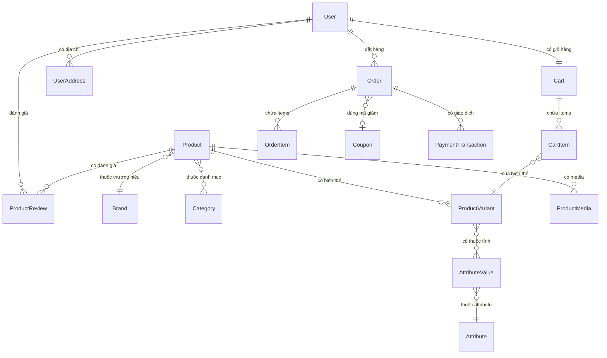
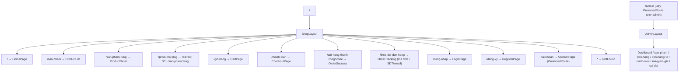

# 📋 KẾ HOẠCH XÂY DỰNG FRONTEND — Core E-commerce (Thiết Bị Điện) — v2 (đã tích hợp review bảo mật)

---

## 📝 CHANGELOG (v1 → v2)

| # | Thay đổi | Lý do (mã trong `frontend_plan_review.md`) |
|---|---|---|
| 1 | Sửa §1.4 "Frontend hiện tại": phân biệt *có file* với *đã hoàn thiện*; ghi lỗi `36.substring(2)` và nút thêm giỏ chưa gọi API | A1, REV P0 |
| 2 | Sửa §1.2: thêm cột **Trạng thái/Bảo mật** cho từng API; ghi rõ admin API đang **mở công khai** | S1, A7 |
| 3 | Thêm **Bước 0 — Chốt hợp đồng & quyết định kiến trúc** (auth, URL, checkout, lỗi, pagination) | REV Bước 0 |
| 4 | **Chốt mô hình auth = Sanctum SPA cookie**; bỏ "refresh token logic" khỏi Pha 0; không lưu token ở localStorage | A2, S3, S4 |
| 5 | Thêm **§2.3 Kiến trúc bảo mật** (admin route group, FormRequest, ẩn exception, APP_DEBUG, CSP, rate limit, env FE) | S1, S9, S11, S13, S14 |
| 6 | Thay cơ chế giỏ khách: **cart token do server cấp trong cookie httpOnly**; cấm cart `session_id=null`; merge giỏ ở server khi login có kiểm tồn kho | S2, S17, E7 |
| 7 | Checkout: **Idempotency-Key + unique constraint DB + khoá tồn kho/giỏ + disable nút** | S7, E4 |
| 8 | Coupon: chống dò mã, giới hạn sử dụng, khoá dòng, `discount ≤ subtotal`; tổng tiền chỉ lấy từ server | S6 |
| 9 | Tra cứu đơn: `order_code` + SĐT/email, policy, throttle; admin dùng route model binding + policy | S10 |
| 10 | Thanh toán online tách khỏi MVP; MVP chỉ COD; yêu cầu xác minh chữ ký IPN khi làm | S8, REV |
| 11 | Thêm lớp server-state **TanStack Query**; Context chỉ giữ auth/UI | A4 |
| 12 | Chuẩn hợp đồng lỗi `ApiError` và xử lý 401/419/422/429/5xx | A5, S14 |
| 13 | Hạ tầng: sửa mount nginx, không publish MySQL/Redis, Redis password, proxy Vite trong Docker, CORS theo env, `npm ci`, build FE production + SPA fallback | A10, S5, S15, S16 |
| 14 | Pha 1 mới: **1.0 Tiên quyết bảo mật backend** phải xong trước khi làm layout/trang chủ | S1, S2, S9 |
| 15 | Catalog filter/sort khớp `GetProductsDTO`; bỏ filter rating/sort tên cho tới khi backend hỗ trợ; URL `/san-pham/:slug` + redirect từ `/products/:slug` | A8, A9, REV P1 |
| 16 | Thêm **tiêu chí nghiệm thu** cho từng pha; timeline tách FE / BE / tích hợp, đánh dấu ước lượng sơ bộ | REV P1, P2 |
| 17 | Đưa PWA, dark mode, animation ra khỏi MVP; PWA không cache `/api/*`; thay React Helmet bằng metadata React 19 / `react-helmet-async` | A11, S15, REV P2 |
| 18 | Thêm §8 "Cần xác nhận" — các quyết định nghiệp vụ chưa chốt | REV |
| 19 | Khôi phục nguyên văn các phần bản nháp v2 chỉ ghi "giữ như v1" (wireframe trang chủ, danh sách SP, checkout; Pha 5/6/7; §5 UI/UX; ước lượng Pha 4–7) và gộp bổ sung bảo mật vào đúng các mục đó | giữ nội dung v1 |

---

## 1. PHÂN TÍCH HIỆN TRẠNG

### 1.1 Kiến trúc hệ thống

| Thành phần | Công nghệ | Trạng thái (đã xác minh từ code) |
|---|---|---|
| **Backend** | Laravel 11 + Sanctum + MySQL 8 + Redis | 🟡 Có catalog/cart/checkout cơ bản; **chưa có auth API, chưa có phân quyền, chưa có rate limit** |
| **Frontend** | React 19 + TypeScript + Vite 8 + TailwindCSS 4 | 🟡 Mới khởi tạo |
| **Routing** | react-router-dom v7 | ✅ Đã cài đặt |
| **HTTP Client** | Axios | ✅ Đã cài (2 instance rời rạc, cần hợp nhất) |
| **Icons** | lucide-react | ✅ Đã cài đặt |
| **Infrastructure** | Docker Compose (nginx, mysql, redis) | 🔴 Cần sửa: mount nginx sai đường dẫn (`./docker/nginx` vs `backend/docker/nginx`), MySQL/Redis publish ra host, mật khẩu cứng, FE chạy dev server |

### 1.2 Backend API hiện có

| API Endpoint | Method | Mục đích | Controller | Trạng thái / Bảo mật |
|---|---|---|---|---|
| `/api/products` | GET | Danh sách sản phẩm | Shop\ProductController@index | ✅ Dùng được; cần clamp `per_page` |
| `/api/products/{slug}` | GET | Chi tiết sản phẩm | Shop\ProductController@show | ✅ Dùng được |
| `/api/cart` | GET/POST | Xem / thêm giỏ | Shop\CartController | 🔴 **Cần sửa**: định danh qua `X-Session-ID` client tự sinh → IDOR |
| `/api/cart/{itemId}` | PUT/DELETE | Sửa / xoá item | Shop\CartController | 🔴 Cần sửa (như trên) |
| `/api/checkout` | POST | Đặt hàng | Shop\OrderController@store | 🔴 **Cần sửa**: không idempotency, không throttle, coupon `exists` cho phép dò mã |
| `/api/products` | POST | [Admin] Tạo SP | Admin\ProductController@store | 🔴 **Critical: không auth**, dùng `$request->all()` |
| `/api/orders/{id}/status` | PATCH | [Admin] Cập nhật trạng thái | Admin\OrderController@updateStatus | 🔴 **Critical: không auth**, id tuần tự |
| `/api/user` | GET | Thông tin user | Closure | ✅ Có `auth:sanctum` |

> [!CAUTION]
> Hai endpoint admin hiện **ai cũng gọi được**. Phải khoá trong Pha 1.0 trước khi bất kỳ trang nào được deploy ra môi trường chung.

### 1.3 Data Models (17 Models)



### 1.4 Frontend hiện tại — Những gì đã có

| Mục | File | Trạng thái thực tế |
|---|---|---|
| Page chi tiết sản phẩm | `frontend/src/pages/shop/ProductDetail.tsx` | 🟡 Hiển thị được; **nút thêm giỏ chưa gọi API**; không reset loading/huỷ request khi đổi slug; dùng `via.placeholder.com` |
| Service sản phẩm | `services/productService.ts` | 🟡 Dùng axios mặc định, không qua client chung |
| Service giỏ hàng | `services/cartService.ts` | 🔴 Lỗi `Math.random().toString(36.substring(2))`; session ID không an toàn; header tính 1 lần lúc import |
| Types sản phẩm | `types/product.ts` | ✅ Có |
| Routing | `App.tsx` | 🟡 Chỉ có `/` và `/products/:slug`; chưa có 404 |

---

## 2. KIẾN TRÚC FRONTEND ĐỀ XUẤT

### 2.1 Cấu trúc thư mục

```
frontend/src/
├── assets/                    # Static assets (gồm ảnh placeholder nội bộ)
├── components/
│   ├── common/                # Button, Input, Modal, Badge, Skeleton, Pagination,
│   │                          # StarRating, PriceDisplay, EmptyState, Toast,
│   │                          # Breadcrumb, ErrorBoundary, ProtectedRoute, SafeText
│   ├── shop/                  # Header/*, Footer, ProductCard, ProductGrid,
│   │                          # CategorySidebar, FilterPanel, CartDrawer,
│   │                          # ReviewSection, ImageGallery, BrandBanner
│   └── admin/                 # Sidebar, TopBar, StatCard, DataTable,
│                              # OrderStatusBadge, ProductForm
├── contexts/
│   ├── AuthContext.tsx        # Chỉ giữ user hiện tại (lấy từ /api/user) — KHÔNG giữ token
│   └── ToastContext.tsx
├── queries/                   # 🆕 TanStack Query: useProductsQuery, useCartQuery, useCheckoutMutation...
├── hooks/                     # useAuth, useDebounce, useCrossTabSync
├── layouts/                   # ShopLayout, AdminLayout (lazy)
├── pages/shop/ ...            # HomePage, ProductList, ProductDetail, CartPage, CheckoutPage,
│                              # OrderSuccess, OrderTracking, LoginPage, RegisterPage, AccountPage, NotFound
├── pages/admin/ ...           # (lazy-load, bundle riêng)
├── services/
│   ├── apiClient.ts           # Axios DUY NHẤT: withCredentials, withXSRFToken, chuẩn hoá ApiError
│   ├── productService.ts, cartService.ts, authService.ts, orderService.ts,
│   ├── categoryService.ts, couponService.ts, adminService.ts
├── types/                     # product, cart, order, user, category, coupon, api (ApiResponse, ApiError, Paginated)
├── utils/                     # formatCurrency (Intl vi-VN/VND), formatDate, cn, idempotencyKey
├── App.tsx, index.css, main.tsx
```

> Thay đổi so với v1: bỏ `CartContext` + `useLocalStorage` cho giỏ/auth (giỏ là server-state qua TanStack Query; không lưu token/cart id ở localStorage).

### 2.2 Routing Map



> [!IMPORTANT]
> `ProtectedRoute` chỉ là UX. **Mọi kiểm soát quyền thực hiện ở server** (middleware + Policy). URL chuẩn `/san-pham/:slug` cần xác nhận ở Bước 0 (§8).

### 2.3 🆕 Kiến trúc bảo mật (bắt buộc, áp dụng xuyên suốt)

#### 2.3.1 Mô hình xác thực — **Sanctum SPA cookie** (quyết định)
- Backend: `bootstrap/app.php` → `->withMiddleware(fn ($m) => $m->statefulApi())`; `.env`: `SANCTUM_STATEFUL_DOMAINS`, `SESSION_DOMAIN`, `SESSION_SECURE_COOKIE=true` (prod), `SESSION_SAME_SITE=lax`, `SESSION_DRIVER=redis`.
- Frontend: `axios.create({ baseURL: import.meta.env.VITE_API_BASE_URL ?? '/api', withCredentials: true, withXSRFToken: true })`; gọi `GET /sanctum/csrf-cookie` trước login/register.
- **Không** có refresh token, **không** lưu token ở localStorage/sessionStorage. Khôi phục phiên = gọi `/api/user` khi khởi động.
- Đăng nhập: `session()->regenerate()`; đăng xuất: `invalidate()` + `regenerateToken()`.
- (Nếu sau này có mobile app → token riêng với `expiration` hữu hạn, không áp dụng cho web.)

#### 2.3.2 Bảo vệ API backend
```php
// routes/api.php
Route::prefix('admin')->middleware(['auth:sanctum', 'can:admin'])->group(function () {
    Route::post('/products', [AdminProductController::class, 'store']);
    Route::patch('/orders/{order}/status', [AdminOrderController::class, 'updateStatus']);
});
```
- Thêm cột `role` (hoặc bảng roles) cho `users`; `Gate::define('admin', fn (User $u) => $u->role === 'admin')`.
- **Mọi** endpoint ghi dữ liệu dùng **FormRequest** (`StoreProductRequest`, `UpdateOrderStatusRequest`, ...); cấm `$request->all()`; chỉ dùng `$request->validated()`; model khai báo `$fillable`.
- **Ẩn exception**: controller không trả `$e->getMessage()`. Tạo `DomainException` (vd. `OutOfStockException`, `EmptyCartException`) có `code` + message an toàn; handler trong `withExceptions` map exception khác → 500 `{success:false, code:'SERVER_ERROR', message:'Đã có lỗi xảy ra'}` và log chi tiết.
- **APP_DEBUG=false**, `APP_ENV=production`, `LOG_LEVEL=warning` ở production; `.env.example` ghi chú rõ.

#### 2.3.3 Rate limiting (định nghĩa trong `AppServiceProvider` bằng `RateLimiter::for`)

| Nhóm | Giới hạn | Khoá theo |
|---|---|---|
| `login`, `register`, `forgot-password` | 5 / phút | email + IP |
| `checkout` | 10 / phút | user hoặc cart token + IP |
| `coupon-check` | 10 / phút | IP + cart token |
| `order-lookup` (guest) | 5 / phút | IP |
| `cart` (POST/PUT/DELETE) | 60 / phút | cart token + IP |
| API đọc chung (`products`, `categories`) | 120 / phút | IP |

FE xử lý **429**: toast "Thao tác quá nhanh, thử lại sau N giây" (đọc `Retry-After`).

#### 2.3.4 XSS / CSP / headers
- Cấm `dangerouslySetInnerHTML`. Nếu `description` là rich text: sanitize ở server (HTMLPurifier) khi lưu **và** DOMPurify khi render, qua 1 component `SafeHtml` duy nhất.
- Review comment, `specifications`, tên SP: render dạng text thuần.
- URL ảnh: chỉ chấp nhận `https?://` (validate ở server, kiểm lại ở FE).
- Nginx thêm header: `Content-Security-Policy: default-src 'self'; img-src 'self' data: <CDN>; script-src 'self'; style-src 'self' 'unsafe-inline'; connect-src 'self'; frame-ancestors 'none'`, `X-Content-Type-Options: nosniff`, `Referrer-Policy: strict-origin-when-cross-origin`, `Strict-Transport-Security` (prod).

#### 2.3.5 Biến môi trường frontend
- Chỉ biến **công khai** mới được đặt `VITE_*` (`VITE_API_BASE_URL`, `VITE_APP_NAME`). Mọi secret (cổng thanh toán, API key) chỉ ở backend. Review `.env*` trong mỗi PR.

#### 2.3.6 Hợp đồng lỗi chuẩn
```ts
type ApiError = { status: number; code: string; message: string; fieldErrors?: Record<string, string[]>; retryAfter?: number };
```
Interceptor: 401 → xoá user, chuyển `/dang-nhap?redirect=`; 419 → gọi lại `/sanctum/csrf-cookie` và retry **1 lần**; 422 → lỗi field; 429 → retryAfter; 5xx/network → thông báo chung + nút thử lại.

---

## 3. KẾ HOẠCH THỰC HIỆN THEO PHA

### ═══════════════════════════════════════
### 🧭 BƯỚC 0 — CHỐT HỢP ĐỒNG & QUYẾT ĐỊNH (Ưu tiên: ⚡ CRITICAL)
### ═══════════════════════════════════════

| # | Task | Mô tả |
|---|---|---|
| 0.A | Phân loại API | Mỗi API: đã có / cần sửa / cần xây mới (xem §1.2, §6) |
| 0.B | Chốt auth | Sanctum SPA cookie (§2.3.1) — xác nhận domain dev/prod |
| 0.C | Chốt URL | `/san-pham/:slug` + redirect `/products/:slug` |
| 0.D | Chốt response | `{success, data, message}` + `ApiError`; pagination Laravel `meta/links` |
| 0.E | Chốt checkout MVP | COD; guest checkout có/không; phí ship (hiện cứng 30.000đ ở server) |

**Tiêu chí hoàn thành:** danh sách API có ví dụ request/response/lỗi được FE + BE xác nhận; không còn quyết định mở nào chặn API client hoặc checkout.

---

### ═══════════════════════════════════════
### 🏗️ PHA 0 — NỀN TẢNG & DESIGN SYSTEM (Ưu tiên: ⚡ CRITICAL)
### ═══════════════════════════════════════

| # | Task | File(s) | Mô tả |
|---|---|---|---|
| 0.1 | API Client duy nhất | `services/apiClient.ts` | `withCredentials`, `withXSRFToken`, interceptor chuẩn hoá `ApiError` (§2.3.6). **Không có token attach/refresh token.** Migrate `productService`, `cartService` sang client này |
| 0.2 | TanStack Query | `main.tsx`, `queries/*` | QueryClient (retry 1 cho GET, 0 cho mutation), AbortSignal theo request |
| 0.3 | Utility `cn()` | `utils/cn.ts` | clsx + tailwind-merge |
| 0.4 | Format helpers | `utils/formatCurrency.ts`, `formatDate.ts` | `Intl.NumberFormat('vi-VN',{style:'currency',currency:'VND'})`; **FE không tự tính tổng tiền cuối** |
| 0.5 | Design Tokens | `index.css` | CSS variables brand |
| 0.6 | Common Components | `components/common/*` | Chỉ những component cần cho vertical slice đầu (REV) |
| 0.7 | Toast + ErrorBoundary | `contexts/ToastContext.tsx`, `ErrorBoundary.tsx` | Error Boundary đưa lên từ Pha 7 |
| 0.8 | Types | `types/*` | `api.ts` (ApiResponse, ApiError, Paginated), cart, order, user... |
| 0.9 | Lint bảo mật | `.oxlintrc.json` | Cấm `dangerouslySetInnerHTML`, `eval` |

**Nghiệm thu:** mọi request đi qua `apiClient`; lỗi 401/419/422/429/5xx hiển thị đúng; build + lint pass.

---

### ═══════════════════════════════════════
### 🛍️ PHA 1 — TIÊN QUYẾT BẢO MẬT BACKEND + SHOP LAYOUT & TRANG CHỦ (Ưu tiên: 🔴 HIGH)
### ═══════════════════════════════════════

> Mục tiêu: Khoá các lỗ hổng Critical ở backend/hạ tầng **trước**, sau đó xây khung layout và trang chủ.

#### 1.0 🔐 Tiên quyết bảo mật backend & hạ tầng (BẮT BUỘC làm trước 1.1)

| # | Task | Mô tả |
|---|---|---|
| 1.0.1 | Hạ tầng Docker | Sửa mount `./backend/docker/nginx/default.conf`; bỏ publish cổng MySQL/Redis (hoặc bind `127.0.0.1`); mật khẩu qua `.env`; Redis `requirepass`; `.env.example` dùng MySQL/Redis thật |
| 1.0.2 | Config an toàn | `APP_DEBUG=false` cho prod; CORS `allowed_origins` từ env; `statefulApi()`; cấu hình session/Sanctum (§2.3.1) |
| 1.0.3 | Khoá admin API | Route group `admin` + `auth:sanctum` + `can:admin`; cột `role`; Gate `admin` |
| 1.0.4 | FormRequest admin | `StoreProductRequest`, `UpdateOrderStatusRequest`; bỏ `$request->all()` |
| 1.0.5 | Ẩn exception | Domain exceptions + handler chung; controller không trả `$e->getMessage()` |
| 1.0.6 | Cart token server-side | Xem §3 Pha 3 — phần backend làm ngay ở đây vì là Critical |
| 1.0.7 | Rate limiter | Định nghĩa các limiter §2.3.3, gắn vào route hiện có |
| 1.0.8 | Security headers | CSP + headers §2.3.4 trong nginx |
| 1.0.9 | API catalog phụ | `GET /api/categories` (tree), `GET /api/brands`, `GET /api/products?is_featured=1` (cần cho trang chủ) |
| 1.0.10 | Test | Feature test cho các mục trên |

#### 1.1 – 1.9 Frontend

| # | Task | File(s) | Mô tả |
|---|---|---|---|
| 1.1 | **Shop Layout** | `layouts/ShopLayout.tsx` | Header sticky + Main + Footer |
| 1.2 | **Navbar / Header** | `components/shop/Header/*` | Logo, Search (submit → `/san-pham?search=`; auto-suggest để sau khi có API), danh mục từ `/api/categories`, Cart badge (từ `useCartQuery`), User menu |
| 1.3 | **Footer** | `components/shop/Footer.tsx` | Thông tin, chính sách, hotline |
| 1.4 | **Hero Banner** | `HomePage.tsx` | Carousel tĩnh (có pause, a11y); nội dung động để sau khi có API settings |
| 1.5 | **Danh mục nổi bật** | `HomePage.tsx` | Từ `/api/categories` |
| 1.6 | **Sản phẩm nổi bật** | `HomePage.tsx` | `is_featured` |
| 1.7 | **Thương hiệu** | `HomePage.tsx` | Từ `/api/brands` |
| 1.8 | **ProductCard** | `ProductCard.tsx` | Text thuần, ảnh fallback nội bộ, giá format bằng `formatCurrency` |
| 1.9 | **Routing** | `App.tsx` | Routes §2.2, redirect `/products/:slug`, 404, lazy admin |

**Nghiệm thu Pha 1:** gọi admin API không đăng nhập → 401, user thường → 403; không còn endpoint trả message exception thô; MySQL/Redis không truy cập được từ ngoài; header CSP có mặt; trang chủ có loading/empty/error state, responsive mobile; refresh URL sâu không 404.

#### 🎨 Wireframe mô tả — Trang chủ

```
┌─────────────────────────────────────────────────────────────┐
│  🔌 LOGO    [🔍 Tìm kiếm sản phẩm...]    🛒(3)  👤 Đăng nhập │
├─────────────────────────────────────────────────────────────┤
│ ▸ Đèn LED  ▸ Thiết bị đóng cắt  ▸ Ổ cắm  ▸ Dây cáp  ▸ ...│
├─────────────────────────────────────────────────────────────┤
│                                                             │
│  ┌───────────────────────────────────────────────────────┐  │
│  │          🎯 HERO BANNER CAROUSEL                      │  │
│  │     "Đèn LED Panel Rạng Đông - Giảm 30%"             │  │
│  │              ● ○ ○ ○                                  │  │
│  └───────────────────────────────────────────────────────┘  │
│                                                             │
│  ═══ DANH MỤC NỔI BẬT ═════════════════════════════════   │
│  ┌──────┐  ┌──────┐  ┌──────┐  ┌──────┐  ┌──────┐        │
│  │💡    │  │⚡    │  │🔌    │  │🔧    │  │📡    │        │
│  │Đèn   │  │Aptomat│  │Ổ cắm │  │Dây   │  │Tủ    │        │
│  │LED   │  │MCB   │  │Công  │  │Cáp   │  │Điện  │        │
│  └──────┘  └──────┘  └──────┘  └──────┘  └──────┘        │
│                                                             │
│  ═══ SẢN PHẨM NỔI BẬT ════════════════════════════════   │
│  ┌─────────┐ ┌─────────┐ ┌─────────┐ ┌─────────┐         │
│  │  [img]  │ │  [img]  │ │  [img]  │ │  [img]  │         │
│  │ Tên SP  │ │ Tên SP  │ │ Tên SP  │ │ Tên SP  │         │
│  │ 150.000đ│ │ 89.000đ │ │ 320.000đ│ │ 45.000đ │         │
│  │[Thêm🛒]│ │[Thêm🛒]│ │[Thêm🛒]│ │[Thêm🛒]│         │
│  └─────────┘ └─────────┘ └─────────┘ └─────────┘         │
│                                                             │
│  ═══ THƯƠNG HIỆU ĐỐI TÁC ════════════════════════════   │
│  [Rạng Đông] [Panasonic] [Schneider] [Sino] [Cadivi]      │
│                                                             │
├─────────────────────────────────────────────────────────────┤
│  FOOTER: Về chúng tôi │ Chính sách │ Hotline │ Mạng XH    │
└─────────────────────────────────────────────────────────────┘
```

---

### ═══════════════════════════════════════
### 🔍 PHA 2 — CATALOG & TÌM KIẾM (Ưu tiên: 🔴 HIGH)
### ═══════════════════════════════════════

| # | Task | File(s) | Mô tả |
|---|---|---|---|
| 2.1 | Trang danh sách | `ProductList.tsx` | Grid + filter + sort + pagination |
| 2.2 | Filter Panel | `FilterPanel.tsx` | **Chỉ** `category_id`, `brand_id`, `search`, `min_price`, `max_price` (theo `GetProductsDTO`). Rating filter: chờ backend |
| 2.3 | Category Sidebar | `CategorySidebar.tsx` | Tree parent_id |
| 2.4 | Search | `SearchBar.tsx` | Debounce 300ms; auto-suggest khi có endpoint |
| 2.5 | Sort | `ProductList.tsx` | Giá trị `sort_by` đã xác minh ở Bước 0 |
| 2.6 | Product Grid | `ProductGrid.tsx` | Skeleton |
| 2.7 | Breadcrumb | `Breadcrumb.tsx` | |
| 2.8 | URL state | `useSearchParams` | Filter/page trên URL; đổi filter → reset `page=1`; backend clamp `per_page ≤ 48` |
| 2.9 | ProductDetail fix | `ProductDetail.tsx` | Reset state khi đổi slug, huỷ request cũ, 404 thật |

**Nghiệm thu:** back/forward giữ filter; page vượt tổng → về trang cuối/empty state; không request trùng khi gõ search.

#### 🎨 Wireframe — Trang danh sách sản phẩm

```
┌─────────────────────────────────────────────────────────────┐
│ 📍 Trang chủ > Đèn LED > Đèn LED Panel                     │
├──────────────┬──────────────────────────────────────────────┤
│              │  Sắp xếp: [Mới nhất ▼]  Hiển thị: ▦ ≡      │
│  BỘ LỌC     ├──────────────────────────────────────────────┤
│              │  ┌────────┐ ┌────────┐ ┌────────┐ ┌────────┐│
│ ▾ Danh mục   │  │ [img]  │ │ [img]  │ │ [img]  │ │ [img]  ││
│  ☐ Đèn Panel │  │ Tên SP │ │ Tên SP │ │ Tên SP │ │ Tên SP ││
│  ☐ Đèn Âm trần│ │150.000đ│ │ 89.000đ│ │320.000đ│ │ 45.000đ││
│  ☐ Đèn Ốp trần│ │ ★★★★☆ │ │ ★★★★★ │ │ ★★★☆☆ │ │ ★★★★☆ ││
│              │  └────────┘ └────────┘ └────────┘ └────────┘│
│ ▾ Thương hiệu│                                              │
│  ☐ Rạng Đông │  ┌────────┐ ┌────────┐ ┌────────┐ ┌────────┐│
│  ☐ Panasonic │  │ [img]  │ │ [img]  │ │ [img]  │ │ [img]  ││
│  ☐ Philips   │  │  ...   │ │  ...   │ │  ...   │ │  ...   ││
│              │  └────────┘ └────────┘ └────────┘ └────────┘│
│ ▾ Khoảng giá │                                              │
│  50K - 500K  │         ◀ 1  2  3  4  5  ▶                  │
├──────────────┴──────────────────────────────────────────────┤
```

> Sao trên card là hiển thị đánh giá. Bộ lọc theo rating và sort theo tên **chưa** bật cho tới khi backend hỗ trợ (task 2.2, 2.5).

---

### ═══════════════════════════════════════
### 🛒 PHA 3 — GIỎ HÀNG & THANH TOÁN (Ưu tiên: 🔴 HIGH)
### ═══════════════════════════════════════

#### 3.A Cơ chế giỏ khách (backend phần lõi đã làm ở 1.0.6)
- Server cấp **cart token** `Str::random(40)` (≥128 bit) trong cookie `cart_token` — `HttpOnly`, `Secure` (prod), `SameSite=Lax` — ở lần gọi giỏ đầu tiên; lưu **hash** token vào `carts.session_id` (hoặc cột `token_hash`, unique).
- Bỏ `X-Session-ID` header và `session_id` trong body; FE **không** sinh/lưu ID giỏ.
- **Cấm cart `session_id=null` & `user_id=null`**: nếu không có định danh → cấp token mới, không bao giờ tạo/tìm cart theo null.
- Hết hạn giỏ khách (vd. 30 ngày) + job dọn dẹp.
- **Merge khi login (server-side)**: trong AuthController sau `regenerate()`, gọi `mergeGuestCartToUser` trong transaction, `lockForUpdate` variant, **clamp số lượng ≤ tồn kho**, bỏ item biến thể inactive, trả về cart + danh sách item bị điều chỉnh; xoá cookie `cart_token`. FE chỉ refetch `['cart']` và hiển thị thông báo điều chỉnh.

#### 3.B Checkout an toàn
- **Idempotency**: FE sinh `crypto.randomUUID()` khi vào CheckoutPage, gửi header `Idempotency-Key`; giữ nguyên key khi retry, tạo key mới khi giỏ thay đổi.
- Backend: cột `orders.idempotency_key` + **UNIQUE (`idempotency_key`, `user_id`/cart)**; nếu key đã tồn tại → trả lại đơn cũ (200), bắt `UniqueConstraintViolationException` cho request đồng thời.
- **Khoá**: đầu transaction `lockForUpdate` bản ghi cart, rồi variant theo thứ tự id tăng dần (tránh deadlock); kiểm `is_active` + tồn kho; trừ kho.
- FE: disable nút "ĐẶT HÀNG NGAY" khi mutation pending, chặn double submit, giữ dữ liệu form khi lỗi/419.
- **Server là nguồn duy nhất** cho giá, giảm giá, phí ship, tổng; FE hiển thị từ response và báo "giá đã thay đổi" nếu khác.

#### 3.C Coupon chống lạm dụng
- Bỏ rule `exists:coupons,code` trong `CheckoutRequest`; mã sai/hết hạn → lỗi chung `COUPON_INVALID`.
- Kiểm `usage_limit`, giới hạn mỗi user/SĐT, thời hạn, `min_order_amount`; `discount = min(discount, subtotal)`.
- `lockForUpdate` coupon trước khi `increment('used_count')`.
- `/api/coupons/check` chỉ để preview, throttle 10/phút.

| # | Task | File(s) | Mô tả |
|---|---|---|---|
| 3.1 | Cart queries | `queries/cart.ts` | `useCartQuery`, mutations add/update/remove, invalidate; bỏ qua response cũ |
| 3.2 | Cart Drawer | `CartDrawer.tsx` | Focus trap, ESC; +/− debounce |
| 3.3 | CartPage | `CartPage.tsx` | Hiển thị cảnh báo hết hàng/biến thể ngừng bán |
| 3.4 | CheckoutPage | `CheckoutPage.tsx` | Form + validate SĐT VN; **MVP chỉ COD**; Idempotency-Key; nút disable |
| 3.5 | OrderSuccess | `OrderSuccess.tsx` | `/dat-hang-thanh-cong/:code`; refresh → lấy đơn theo §3.D |
| 3.6 | Coupon Service | `couponService.ts` | Preview qua `/coupons/check` |
| 3.7 | Order Service | `orderService.ts` | createOrder với Idempotency-Key |
| 3.8 | ProductDetail | `ProductDetail.tsx` | Nút thêm giỏ gọi API, kiểm biến thể/tồn kho, toast |
| 3.9 | Đồng bộ đa tab | `useCrossTabSync.ts` | `BroadcastChannel('cart')`, refetch khi `visibilitychange` |
| 3.10 | Image Gallery | `ImageGallery.tsx` | |

#### 3.D Tra cứu đơn
- Guest: `POST /api/orders/lookup` với `order_code` + `phone` (hoặc email), so khớp server, throttle 5/phút, lỗi chung khi không khớp; response che bớt PII.
- User: `/api/user/orders/{code}` qua Policy `view` (chỉ chủ đơn).
- Admin: route model binding + Policy.

**Nghiệm thu Pha 3:** đổi/đoán cart token không truy cập được giỏ khác; double-click/retry chỉ tạo 1 đơn; 2 request song song mua hàng cuối cùng → 1 thành công, 1 lỗi hết hàng; coupon sai không phân biệt "không tồn tại"/"hết hạn"; tổng hiển thị = server.

#### 🎨 Wireframe — Trang Checkout

> Phương thức thanh toán MVP: chỉ **COD**. Trong wireframe bên dưới, "Chuyển khoản ngân hàng" và "VNPay / Momo" **ẩn** cho đến Pha thanh toán online (cần IPN + xác minh chữ ký phía server).

```
┌─────────────────────────────────────────────────────────────┐
│ 📍 Trang chủ > Thanh toán                                   │
├─────────────────────────────────┬───────────────────────────┤
│                                 │                           │
│  THÔNG TIN GIAO HÀNG           │  ĐƠN HÀNG CỦA BẠN       │
│                                 │                           │
│  Họ và tên: [____________]      │  ┌─────────────────────┐ │
│  Số điện thoại: [________]      │  │ 🔌 Đèn LED Panel    │ │
│  Email: [________________]      │  │ 18W │ x2 │ 300.000đ│ │
│                                 │  ├─────────────────────┤ │
│  Tỉnh/TP: [Chọn ▼]            │  │ ⚡ Aptomat 2P 20A   │ │
│  Quận/Huyện: [Chọn ▼]          │  │      │ x1 │  85.000đ│ │
│  Phường/Xã: [Chọn ▼]           │  └─────────────────────┘ │
│  Địa chỉ cụ thể: [_________]   │                           │
│                                 │  Tạm tính:    385.000đ   │
│  GHI CHÚ ĐƠN HÀNG             │  Phí vận chuyển: 30.000đ  │
│  [______________________]       │  Mã giảm giá: [-15.000đ] │
│                                 │  ───────────────────────  │
│  PHƯƠNG THỨC THANH TOÁN        │  TỔNG:        400.000đ   │
│  ◉ COD - Thanh toán khi nhận   │                           │
│  ○ Chuyển khoản ngân hàng      │  [    ĐẶT HÀNG NGAY    ] │
│  ○ VNPay / Momo                │                           │
├─────────────────────────────────┴───────────────────────────┤
```

---

### ═══════════════════════════════════════
### 🔐 PHA 4 — XÁC THỰC & TÀI KHOẢN (Ưu tiên: 🟠 MEDIUM)
### ═══════════════════════════════════════

> Mục tiêu: Hệ thống đăng nhập/đăng ký, quản lý tài khoản cá nhân. Auth đã chốt là Sanctum SPA cookie (§2.3.1): gọi `/sanctum/csrf-cookie` trước login, **không** dùng token-based và **không** lưu token.

| # | Task | File(s) | Mô tả |
|---|---|---|---|
| 4.1 | **Auth Context** | `contexts/AuthContext.tsx`, `hooks/useAuth.ts` | Quản lý user state lấy từ `/api/user`, login/logout. **Không giữ token**, không persist token |
| 4.2 | **Auth Service** | `services/authService.ts` | `GET /sanctum/csrf-cookie` rồi Login, Register, Logout, Get Profile (session Sanctum) |
| 4.3 | **Trang đăng nhập** | `pages/shop/LoginPage.tsx` | Form email/password, remember me, link đăng ký. Throttle 5/phút; lỗi chung "Email hoặc mật khẩu không đúng" |
| 4.4 | **Trang đăng ký** | `pages/shop/RegisterPage.tsx` | Form tên, email, SĐT, password, confirm password. Throttle 5/phút |
| 4.5 | **Trang tài khoản** | `pages/shop/AccountPage.tsx` | Tabs: Thông tin cá nhân, Lịch sử đơn hàng, Sổ địa chỉ, Đổi mật khẩu (yêu cầu mật khẩu cũ) |
| 4.6 | **Theo dõi đơn hàng** | `pages/shop/OrderTracking.tsx` | Timeline: pending → confirmed → packing → shipping → delivered, cộng `cancelled` và `returned` |
| 4.7 | **Protected Route** | `components/common/ProtectedRoute.tsx` | Redirect về login nếu chưa auth. Chỉ là UX — quyền thật ở server |
| 4.8 | **Merge cart khi login** | server (AuthController) | Gộp giỏ khách vào user cart **ở server** (§3.A); FE chỉ refetch, không merge trong `cartService.ts` |
| 4.9 | **Đa tab** | `hooks/useCrossTabSync.ts` | `BroadcastChannel('auth')` cho logout |

**Effort ước lượng: 3-4 ngày**

**Nghiệm thu:** refresh giữ phiên; logout tab A → tab B về trạng thái khách; 401/419 xử lý đúng; merge trùng biến thể/vượt kho được clamp.

---

### ═══════════════════════════════════════
### ⭐ PHA 5 — ĐÁNH GIÁ & TƯƠNG TÁC (Ưu tiên: 🟠 MEDIUM)
### ═══════════════════════════════════════

> Mục tiêu: Đánh giá sản phẩm, tăng độ tin cậy.

| # | Task | File(s) | Mô tả |
|---|---|---|---|
| 5.1 | **Review Section** | `components/shop/ReviewSection.tsx` | Hiển thị danh sách đánh giá, phân bổ rating (5★/4★/3★...) |
| 5.2 | **Review Form** | `components/shop/ReviewForm.tsx` | Form viết đánh giá: rating sao, comment, upload ảnh |
| 5.3 | **Star Rating component** | `components/common/StarRating.tsx` | Interactive star rating (read-only & editable) |
| 5.4 | **Review Service** | `services/reviewService.ts` | API CRUD review |
| 5.5 | **Tích hợp vào ProductDetail** | `pages/shop/ProductDetail.tsx` | Thêm ReviewSection bên dưới thông số kỹ thuật |

**Effort ước lượng: 2 ngày**

> **Bổ sung v2**
> - Chỉ user đã mua mới được review (chốt ở §8).
> - Render comment dạng text thuần (không HTML).
> - Upload ảnh: `image/jpeg`, `image/png`, `image/webp`, ≤ 2MB, tên file random, không nhận SVG.
> - Throttle endpoint review.

---

### ═══════════════════════════════════════
### 🏢 PHA 6 — ADMIN PANEL (Ưu tiên: 🟡 LOWER)
### ═══════════════════════════════════════

> Mục tiêu: Giao diện quản trị cho admin quản lý sản phẩm, đơn hàng, danh mục, mã giảm giá.

| # | Task | File(s) | Mô tả |
|---|---|---|---|
| 6.1 | **Admin Layout** | `layouts/AdminLayout.tsx` | Sidebar navigation + TopBar (user info) + Main content area |
| 6.2 | **Admin Sidebar** | `components/admin/Sidebar.tsx` | Menu: Dashboard, Sản phẩm, Đơn hàng, Danh mục, Mã giảm giá, Cài đặt |
| 6.3 | **Dashboard** | `pages/admin/Dashboard.tsx` | StatCards: Tổng đơn hàng, Doanh thu hôm nay, SP tồn kho thấp, Đơn chờ xác nhận + Biểu đồ doanh thu |
| 6.4 | **DataTable component** | `components/admin/DataTable.tsx` | Reusable table: sort, search, pagination, actions |
| 6.5 | **Quản lý sản phẩm** | `pages/admin/ProductManagement.tsx` | CRUD sản phẩm: danh sách, tạo mới, sửa, xóa, quản lý variants |
| 6.6 | **Product Form** | `components/admin/ProductForm.tsx` | Form tạo/sửa sản phẩm: thông tin cơ bản, media upload, biến thể, thông số kỹ thuật |
| 6.7 | **Quản lý đơn hàng** | `pages/admin/OrderManagement.tsx` | Danh sách đơn, filter theo trạng thái, tìm kiếm |
| 6.8 | **Chi tiết đơn hàng** | `pages/admin/OrderDetail.tsx` | Thông tin khách hàng, danh sách SP, timeline trạng thái, cập nhật status |
| 6.9 | **Order Status Badge** | `components/admin/OrderStatusBadge.tsx` | Color-coded badges: pending(vàng), confirmed(xanh), shipping(tím), delivered(xanh lá), cancelled(đỏ) |
| 6.10 | **Quản lý danh mục** | `pages/admin/CategoryManagement.tsx` | CRUD danh mục dạng tree (parent-child) |
| 6.11 | **Quản lý mã giảm giá** | `pages/admin/CouponManagement.tsx` | CRUD coupon: code, loại (fixed/percent), giá trị, thời hạn, giới hạn sử dụng |
| 6.12 | **Admin Service** | `services/adminService.ts` | API endpoints cho admin operations |

> [!WARNING]
> Admin panel cần bổ sung thêm API endpoints ở backend (CRUD đầy đủ cho Products, Categories, Orders, Coupons). Hiện tại backend chỉ có `POST /products` (tạo SP) và `PATCH /orders/{id}/status` (cập nhật trạng thái đơn).

**Effort ước lượng: 5-7 ngày**

> **Bổ sung v2**
> - Tất cả API admin nằm dưới `/api/admin/*` với `auth:sanctum` + `can:admin` + FormRequest + Policy.
> - Admin bundle lazy-load riêng (không chờ Pha 7).
> - ProductForm: sanitize rich text ở server trước khi lưu.

---

### ═══════════════════════════════════════
### ✨ PHA 7 — POLISH & UX NÂNG CAO (Ưu tiên: 🟢 NICE-TO-HAVE, ngoài MVP)
### ═══════════════════════════════════════

> Mục tiêu: Hoàn thiện trải nghiệm, tối ưu hiệu năng. Dark mode, animation và PWA nằm ngoài MVP.

| # | Task | Mô tả |
|---|---|---|
| 7.1 | **SEO Optimization** | React Helmet: meta title, description, Open Graph cho từng trang |
| 7.2 | **Lazy Loading** | React.lazy + Suspense cho admin pages, code splitting |
| 7.3 | **Image Optimization** | Lazy load ảnh sản phẩm, blur placeholder, WebP support |
| 7.4 | **Dark Mode** | Toggle dark/light mode (CSS variables đã sẵn sàng) |
| 7.5 | **Responsive Polish** | Kiểm tra & tinh chỉnh mobile/tablet breakpoints |
| 7.6 | **Animations** | Framer Motion cho page transitions, cart animations |
| 7.7 | **PWA Support** | Service Worker, offline mode, install prompt |
| 7.8 | **Error Boundaries** | React Error Boundary cho graceful error handling |
| 7.9 | **404 Page** | Trang NotFound.tsx custom đẹp mắt |
| 7.10 | **Performance Audit** | Lighthouse audit, Web Vitals optimization |

**Effort ước lượng: 3-4 ngày**

> **Bổ sung v2**
> - 7.1: dùng metadata React 19 hoặc `react-helmet-async`, **không** dùng React Helmet.
> - 7.7: PWA chỉ cache static; `/api/*` dùng `NetworkOnly` (không cache response API).
> - 7.8 đã được đưa lên Pha 0 (task 0.7); mục này là kiểm tra lại.
> - Lazy-load admin bundle làm ở Pha 6, không đợi Pha 7.

---

## 4. TỔNG KẾT & TIMELINE (ước lượng sơ bộ — cập nhật sau Bước 0)

| Mốc | FE | BE | Tích hợp |
|---|---|---|---|
| Bước 0 | 0.5 ngày | 0.5 ngày | — |
| Pha 0 | 2–3 ngày | — | 0.5 ngày |
| Pha 1 (1.0 + layout) | 3–4 ngày | 3–4 ngày (bảo mật, categories/brands) | 1 ngày |
| Pha 2 | 3–4 ngày | 0.5–1 ngày | 0.5 ngày |
| Pha 3 | 4–5 ngày | 3–4 ngày (cart token, idempotency, coupon, lookup) | 1–2 ngày |
| Pha 4 | 3–4 ngày | cần ước lượng sau khi chốt API | — |
| Pha 5 | 2 ngày | cần ước lượng sau khi chốt API | — |
| Pha 6 | 5–7 ngày | cần ước lượng sau khi chốt API | — |
| Pha 7 | 3–4 ngày | cần ước lượng sau khi chốt API | — |

> Giả định: 1 FE + 1 BE song song. **MVP = Bước 0 → Pha 3 (COD)**, chỉ khi các đầu việc backend tương ứng hoàn thành. Cột FE của Pha 4–7 lấy từ ước lượng v1 bên dưới; cột BE cập nhật sau khi chốt API.

#### Tham chiếu ước lượng v1 (FE, chưa tách BE)

| Pha | Nội dung | Ước lượng | Tích lũy |
|---|---|---|---|
| **Pha 0** | Nền tảng & Design System | 2-3 ngày | 2-3 ngày |
| **Pha 1** | Shop Layout & Trang chủ | 3-4 ngày | 5-7 ngày |
| **Pha 2** | Catalog & Tìm kiếm | 3-4 ngày | 8-11 ngày |
| **Pha 3** | Giỏ hàng & Thanh toán | 4-5 ngày | 12-16 ngày |
| **Pha 4** | Xác thực & Tài khoản | 3-4 ngày | 15-20 ngày |
| **Pha 5** | Đánh giá & Tương tác | 2 ngày | 17-22 ngày |
| **Pha 6** | Admin Panel | 5-7 ngày | 22-29 ngày |
| **Pha 7** | Polish & UX nâng cao | 3-4 ngày | 25-33 ngày |

> [!TIP]
> **Tổng thời gian ước lượng: ~25-33 ngày làm việc** (5-7 tuần). Pha 0-3 là MVP (Minimum Viable Product) — đủ để vận hành bán hàng cơ bản. Pha 4-7 là nâng cấp trải nghiệm. Bảng trên là ước lượng v1 chỉ tính FE; timeline v2 tách FE / BE / tích hợp và coi MVP là Bước 0 → Pha 3 (COD).

---

## 5. NGUYÊN TẮC THIẾT KẾ UI/UX

### 5.1 Design Language
- **Phong cách**: Clean, professional, tin cậy — phù hợp ngành thiết bị điện B2B/B2C
- **Color Palette**: 
  - Primary: `#2563EB` (Blue 600) — Chuyên nghiệp, đáng tin cậy
  - Accent: `#F59E0B` (Amber 500) — Năng lượng, điện
  - Success: `#10B981` — Hoàn thành, tồn kho
  - Danger: `#EF4444` — Giảm giá, cảnh báo hết hàng
  - Neutral: Gray scale cho text & borders

### 5.2 Typography
- **Heading**: Inter / Be Vietnam Pro (Google Fonts)
- **Body**: System UI fallback stack
- **Price**: Tabular nums, bold, red/blue accent

### 5.3 Key UX Patterns
- **Sticky header** với search always-visible
- **Mini cart drawer** slide-in từ phải (không redirect page)
- **Toast notifications** cho mọi action (add cart, checkout, error...)
- **Skeleton loading** thay vì spinner — cảm giác nhanh hơn
- **Breadcrumb navigation** — luôn biết mình đang ở đâu
- **Mobile-first responsive** — >=60% traffic từ mobile

### 5.4 Bổ sung v2
- **A11y cơ bản**: focus trap và phím ESC cho drawer/modal; carousel có nút pause.
- **Không** hiển thị message lỗi kỹ thuật cho người dùng (dùng thông báo chung, chi tiết chỉ ghi log).

---

## 6. CÁC API BACKEND CẦN BỔ SUNG / SỬA

| API | Method | Pha | Trạng thái | Bảo vệ |
|---|---|---|---|---|
| Admin routes hiện có → `/api/admin/*` | POST/PATCH | 1 | Cần sửa | auth:sanctum + can:admin, FormRequest |
| `/api/cart*` (cart token cookie) | * | 1/3 | Cần sửa | throttle 60/phút |
| `/api/checkout` | POST | 3 | Cần sửa | Idempotency-Key, throttle 10/phút |
| `/api/categories`, `/api/brands` | GET | 1 | Xây mới | throttle 120/phút |
| `/api/coupons/check` | POST | 3 | Xây mới | throttle 10/phút |
| `/api/orders/lookup` | POST | 3 | Xây mới | code + phone, throttle 5/phút |
| `/api/auth/register`, `/login`, `/logout` | POST | 4 | Xây mới | session, throttle 5/phút |
| `/api/auth/profile` | GET/PUT | 4 | Xây mới | auth:sanctum |
| `/api/user/addresses` | CRUD | 4 | Xây mới | auth:sanctum + Policy |
| `/api/user/orders`, `/{code}` | GET | 4 | Xây mới | auth:sanctum + Policy |
| `/api/products/{slug}/reviews` | GET/POST | 5 | Xây mới | POST: auth + throttle |
| `/api/admin/products` | GET/PUT/DELETE | 6 | Xây mới | auth:sanctum + can:admin, FormRequest, Policy |
| `/api/admin/orders` | GET | 6 | Xây mới | auth:sanctum + can:admin, Policy |
| `/api/admin/categories` | GET/POST/PUT/DELETE | 6 | Xây mới | auth:sanctum + can:admin, FormRequest, Policy |
| `/api/admin/coupons` | GET/POST/PUT/DELETE | 6 | Xây mới | auth:sanctum + can:admin, FormRequest, Policy |
| `/api/admin/dashboard/stats` | GET | 6 | Xây mới | auth:sanctum + can:admin |

---

## 7. BƯỚC TIẾP THEO GỢI Ý
1. Bước 0 — chốt hợp đồng & quyết định §8.
2. Pha 1.0 — tiên quyết bảo mật backend/hạ tầng (song song với Pha 0 frontend).
3. Pha 0 → Pha 1 (layout, trang chủ) → Pha 2 → Pha 3 (MVP COD).

## 8. 🆕 CẦN XÁC NHẬN

| Câu hỏi | Tác động nếu để ngỏ |
|---|---|
| Domain dev/prod của FE và API (cùng site?) | Cấu hình Sanctum stateful/CORS/cookie |
| Cho phép guest checkout? | Phạm vi cart token, order lookup |
| URL chuẩn `/san-pham` hay `/products`? | SEO, redirect |
| Phí ship: cố định 30.000đ hay theo khu vực? | Checkout UI, API |
| Coupon: giới hạn mỗi user/SĐT? | Logic chống lạm dụng |
| Địa chỉ: mô hình 2 cấp hay 3 cấp (có Quận/Huyện)? | Validation `shipping_district` |
| Ai được review (chỉ người đã mua)? | Pha 5 |
| Thời điểm làm VNPay/MoMo | Cần IPN + xác minh chữ ký phía server |

---

## Phụ lục A. Checklist Pha 1 — theo thứ tự thực hiện

> Điều kiện đầu vào: Bước 0 đã chốt (domain, URL `/san-pham`, auth = Sanctum SPA cookie). Các mục 1–10 (backend/hạ tầng) **phải xong trước** mục 11+.

### A. Tiên quyết bảo mật backend & hạ tầng

1. **Sửa docker-compose** — mount `./backend/docker/nginx/default.conf`, bỏ publish cổng MySQL/Redis (hoặc bind 127.0.0.1), mật khẩu MySQL/Redis lấy từ `.env`, Redis `requirepass`.
   *Nghiệm thu:* `docker compose up` chạy được nginx; `mysql -h <host-ip> -P 33066` và `redis-cli -p 63790` từ bên ngoài bị từ chối.
2. **Chuẩn hoá `.env.example` & config** — MySQL/Redis thay sqlite/database, `APP_DEBUG=false` cho prod, CORS `allowed_origins` từ env, `SANCTUM_STATEFUL_DOMAINS`, `SESSION_DOMAIN`, `SESSION_SAME_SITE=lax`; bật `statefulApi()`.
   *Nghiệm thu:* `GET /sanctum/csrf-cookie` từ origin FE trả cookie `XSRF-TOKEN`; origin lạ bị CORS chặn.
3. **Thêm role & Gate admin** — migration cột `users.role` (mặc định `customer`), `Gate::define('admin', ...)`, seeder 1 admin.
   *Nghiệm thu:* unit test Gate trả true cho admin, false cho customer.
4. **Khoá admin API** — chuyển `POST /products`, `PATCH /orders/{order}/status` vào group `prefix('admin')->middleware(['auth:sanctum','can:admin'])`.
   *Nghiệm thu:* feature test: chưa đăng nhập → 401, customer → 403, admin → 2xx; route cũ không còn tồn tại.
5. **FormRequest cho admin** — `StoreProductRequest`, `UpdateOrderStatusRequest`; dùng `$request->validated()`; kiểm `$fillable` của model.
   *Nghiệm thu:* gửi field lạ (vd. `view_count`, `id`) không được lưu; thiếu field bắt buộc → 422 có `errors`.
6. **Ẩn exception** — domain exceptions có `code`; handler trong `withExceptions` trả message an toàn cho lỗi không xác định; xoá `$e->getMessage()` khỏi controller.
   *Nghiệm thu:* ép lỗi DB → response 500 `{code:'SERVER_ERROR'}` không có SQL/stack; log có chi tiết.
7. **Cart token server-side** — cấp cookie `cart_token` (HttpOnly, SameSite=Lax, Secure ở prod, random 40 ký tự, lưu hash, unique); bỏ `X-Session-ID`/`session_id` body; không bao giờ tạo/tìm cart với định danh null.
   *Nghiệm thu:* request không cookie → nhận cookie mới và giỏ rỗng; gửi `X-Session-ID` của người khác không đọc được giỏ họ; bảng `carts` không có dòng `user_id IS NULL AND session_id IS NULL`.
8. **Rate limiter** — định nghĩa `login`, `register` (5/phút), `checkout`, `coupon-check` (10/phút), `order-lookup` (5/phút), `cart` (60/phút), `public-read` (120/phút); gắn vào route hiện có.
   *Nghiệm thu:* request thứ 61/phút vào `/api/cart` → 429 có `Retry-After`.
9. **Security headers nginx** — CSP, `X-Content-Type-Options`, `Referrer-Policy`, `frame-ancestors 'none'` (HSTS ở prod).
   *Nghiệm thu:* `curl -I` thấy đủ header; trang FE vẫn tải không lỗi CSP trên console.
10. **API phục vụ trang chủ** — `GET /api/categories` (tree), `GET /api/brands`, hỗ trợ `is_featured` trong `/api/products`; clamp `per_page ≤ 48`; throttle `public-read`.
    *Nghiệm thu:* feature test trả đúng shape `{success, data}`; `per_page=1000` chỉ trả 48.

### B. Nền frontend dùng cho Pha 1 (nếu Pha 0 chưa xong phần này)

11. **apiClient duy nhất** — `withCredentials`, `withXSRFToken`, chuẩn hoá `ApiError`; migrate `productService`; viết lại `cartService` không dùng localStorage/`X-Session-ID`.
    *Nghiệm thu:* `rg "localStorage|X-Session-ID" frontend/src` không còn kết quả; lỗi 401/419/422/429 hiển thị đúng toast.
12. **Sửa proxy Vite trong Docker** — target `http://nginx:80` (qua env), `npm ci` thay `npm install`.
    *Nghiệm thu:* trong container FE, `/api/products` qua proxy trả 200.
13. **TanStack Query + ErrorBoundary + Toast** setup trong `main.tsx`.
    *Nghiệm thu:* lỗi render một component không làm trắng cả app.

### C. Layout & trang chủ

14. **Routing (1.9)** — routes theo §2.2, `/products/:slug` → redirect `/san-pham/:slug`, route `*` → NotFound, admin lazy.
    *Nghiệm thu:* mở trực tiếp + F5 ở `/san-pham/abc` hoạt động; URL cũ chuyển hướng; URL lạ hiện 404.
15. **ShopLayout (1.1)** — Header sticky + Main + Footer.
    *Nghiệm thu:* hiển thị đúng ở 375px, 768px, 1280px.
16. **Header (1.2)** — logo, search (submit → `/san-pham?search=`), menu danh mục từ `/api/categories`, cart badge từ `useCartQuery`, user menu (Đăng nhập).
    *Nghiệm thu:* badge cập nhật sau khi thêm giỏ không cần reload; menu có trạng thái loading/lỗi.
17. **Footer (1.3)**. *Nghiệm thu:* link chính sách/hotline đúng, không link chết.
18. **ProductCard (1.8)** — text thuần, ảnh fallback nội bộ (bỏ `via.placeholder.com`), giá qua `formatCurrency`.
    *Nghiệm thu:* ảnh lỗi → fallback; tên chứa `<script>` hiển thị dạng chữ.
19. **HomePage (1.4–1.7)** — hero carousel (pause, a11y), danh mục nổi bật, sản phẩm nổi bật, thương hiệu.
    *Nghiệm thu:* mỗi section có skeleton/empty/error; carousel dừng khi hover/focus; Lighthouse a11y ≥ 90.
20. **Kiểm thử & nghiệm thu Pha 1** — feature test backend (mục 4–10) xanh; `npm run build` + `npm run lint` pass; không lỗi CSP trên console.
    *Nghiệm thu:* CI/test pass, demo trang chủ end-to-end trên Docker.

